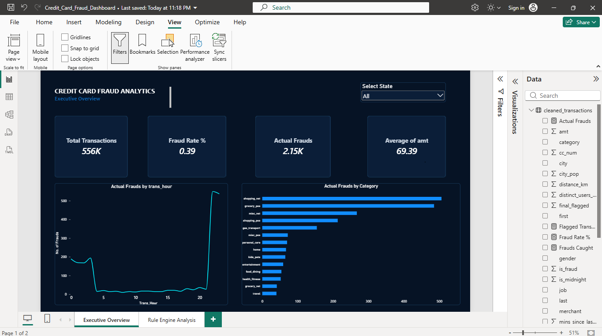
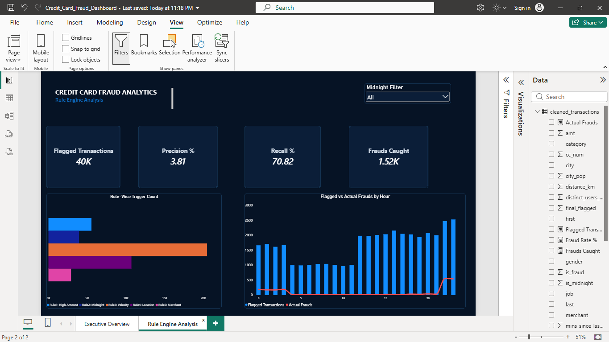
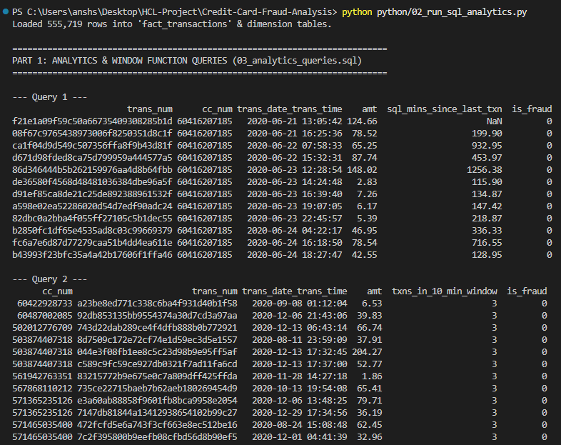
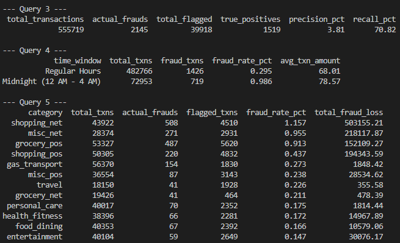
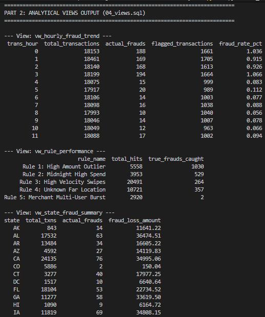

# Credit Card Transaction & Fraud Pattern Analysis

An end-to-end data analytics project built to detect anomalous credit card activity, analyze transaction velocity, and evaluate a 5-rule behavioral fraud engine against actual labelled fraud cases across **555,719 transactions**.


## Problem Statement
Financial institutions lose significant revenue to fraudulent transactions, yet fraudulent activity accounts for only **0.39%** of total transaction volume. Because fraud data is heavily imbalanced, simple averages fail to catch suspicious behavior.

The goal of this project is to build a reproducible data pipeline using **Python, Oracle SQL, and Power BI** to:
- Clean raw transaction logs, engineer temporal/spatial features, and handle severe class imbalance.
- Flag high-risk transactions using a **5-rule behavioral detection engine** (amount outliers, midnight spend, rapid card swipes, distant locations, and merchant bursts).
- Validate rule effectiveness using **Precision** and **Recall** metrics rather than misleading raw accuracy.

---

## Dataset Source
- **Source:** [Credit Card Transactions Fraud Detection Dataset (Kaggle)](https://www.kaggle.com/datasets/kartik2112/fraud-detection) (`fraudTest.csv` split)
- **Volume & Granularity:** `555,719` credit card transactions spanning `2,145` confirmed fraud cases across 14 merchant categories and multiple US states.
- **Key Attributes:** `trans_date_trans_time`, `cc_num`, `merchant`, `category`, `amt`, `city`, `state`, `city_pop`, `lat/long`, `merch_lat/merch_long`, and target label `is_fraud`.

---

## Tech Stack
- **Data Cleaning, Feature Engineering & Rule Engine:** Python (`Pandas`, `NumPy`, `SciPy`)
- **Relational Modeling & Velocity Analytics:** Oracle SQL / SQLite Runner (`Star Schema`, `Window Functions`, `Analytical Views`)
- **Interactive Visualization & Reporting:** Power BI Desktop (`DAX Measures`, `Dynamic Slicers`, `Dual-Axis Charts`)

---

## Project Architecture & Workflow
1. **Data Preparation & Rule Flagging (Python):**
   - Verified zero duplicates/missing values, parsed timestamps (`trans_hour`, `is_midnight`), calculated Haversine distance (`distance_km`) between cardholder and merchant, and computed inter-transaction time gaps (`mins_since_last_txn`).
   - Implemented **5 behavioral fraud rules** and combined them into a unified `final_flagged` alert indicator.
2. **Relational Modeling & SQL Analytics (Oracle SQL):**
   - Designed a Star Schema (`DIM_CARDHOLDER`, `DIM_MERCHANT`, `FACT_TRANSACTIONS`) in `01_ddl.sql` and `02_load.sql`.
   - Used `LAG()` and `RANGE BETWEEN INTERVAL '10' MINUTE PRECEDING` window functions in `03_analytics_queries.sql` to validate swipe velocity, and created 3 reporting views (`vw_hourly_fraud_trend`, `vw_rule_performance`, `vw_state_fraud_summary`) in `04_views.sql`.
3. **Executive & Rule Engine Dashboard (Power BI):**
   - Built a 2-page interactive dashboard (`Executive Overview` and `Rule Engine Analysis`) tracking KPIs, hourly fraud spikes, category risk, and rule-wise trigger volumes.

---

## 5 Fraud Detection Rules Implemented

| Rule ID | Rule Name | Detection Logic | Total Triggers | True Frauds Caught |
| :--- | :--- | :--- | :---: | :---: |
| **Rule 1** | **High Amount Outlier** | Flags transactions exceeding normal spending thresholds (high-value anomalies) | 5,558 | 1,030 |
| **Rule 2** | **Midnight High Spend** | Flags elevated transaction amounts occurring between `12:00 AM` and `4:00 AM` | 3,953 | 529 |
| **Rule 3** | **High Velocity Swipes** | Flags 3 or more consecutive swipes on the same card within a 10-minute window | 20,491 | 264 |
| **Rule 4** | **Unknown Far Location** | Flags transactions occurring at unusually large geographic distances from home coordinates | 10,721 | 357 |
| **Rule 5** | **Merchant Multi-User Burst** | Flags sudden bursts of distinct cardholders transacting at the same merchant in a short window | 2,920 | 2 |

---

## Key Metrics & Results

| Metric | Value | Description |
| :--- | :---: | :--- |
| **Total Transactions Analyzed** | **555,719** | Complete cleaned transaction dataset |
| **Actual Fraud Cases** | **2,145** | Ground-truth fraudulent transactions (`0.39%` base rate) |
| **Total Flagged Alerts** | **39,918** | Transactions flagged by at least one rule (`7.18%` alert rate) |
| **True Frauds Caught** | **1,519** | Fraudulent transactions successfully intercepted |
| **Rule Engine Precision** | **3.81%** | Share of flagged alerts that were actual frauds |
| **Rule Engine Recall** | **70.82%** | Percentage of all actual frauds caught by the 5-rule engine |

### Key Analytical Insights
- **Late-Night Vulnerability:** Fraud rate surges to **0.986%** during midnight hours (`12:00 AM – 4:00 AM`, 719 frauds in 72,953 txns) compared to **0.295%** during regular hours—a **3.3x higher risk**.
- **High-Risk Merchant Categories:** Online shopping (`shopping_net` — 508 frauds, **$503,155.21** loss, `1.157%` fraud rate), `misc_net` (`0.955%` rate), and `grocery_pos` (`0.913%` rate) account for the highest fraud losses.
- **Precision vs. Recall Trade-off:** Rule 1 (`High Amount Outlier`) delivers the highest precision (~18.5% hit-to-fraud conversion), whereas Rule 3 (`High Velocity Swipes`) casts a wide net (`20,491` alerts) to maximize overall recall (`70.82%`).

---

## Dashboard & Execution Previews

### 1. Power BI — Executive Overview


### 2. Power BI — Rule Engine Analysis


### 3. SQL Window Functions & Analytics Output




### 4. SQL Analytical Views Output


---

## Repository Structure
```text
├── data/
│   └── cleaned_transactions.csv               # Processed dataset (555,719 rows)
├── python/
│   ├── 01_data_cleaning_and_rules.ipynb       # EDA, feature engineering & 5-rule flagging
│   └── 02_run_sql_analytics.py                # Automated SQLite runner for Oracle SQL scripts
├── sql/
│   ├── 01_ddl.sql                             # Star Schema table & index definitions
│   ├── 02_load.sql                            # Staging-to-dimension/fact ETL load script
│   ├── 03_analytics_queries.sql               # Window functions (LAG, 10-min RANGE) & KPIs
│   └── 04_views.sql                           # Reporting views for hourly, rule & state trends
├── powerbi/
│   └── Credit_Card_Fraud_Dashboard.pbix       # Interactive 2-page Power BI report
├── docs/
│   └── screenshot/                            # Execution & dashboard verification screenshots
└── README.md